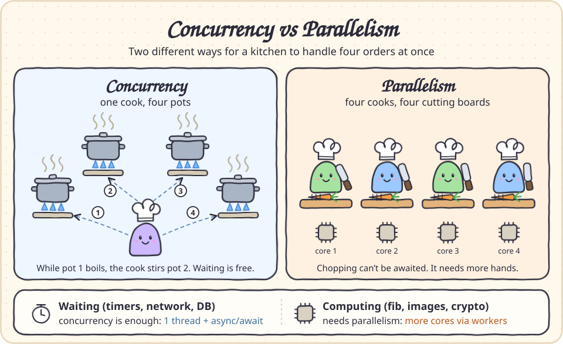
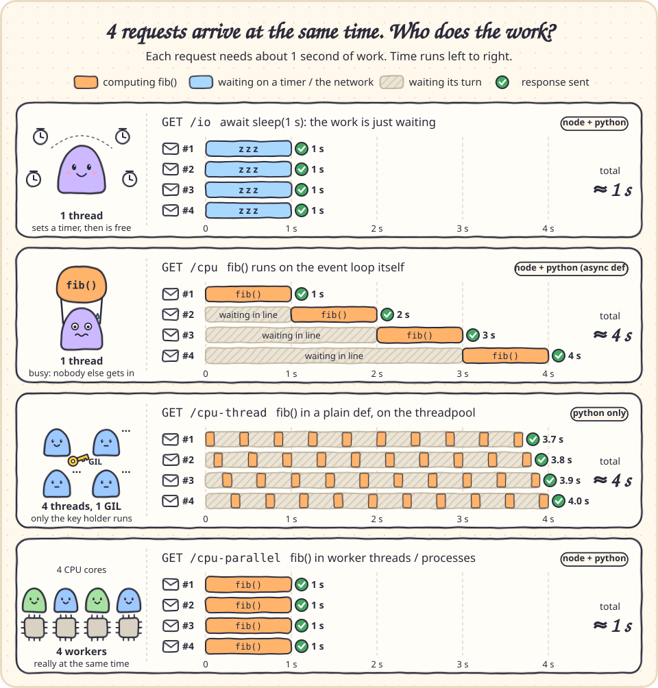
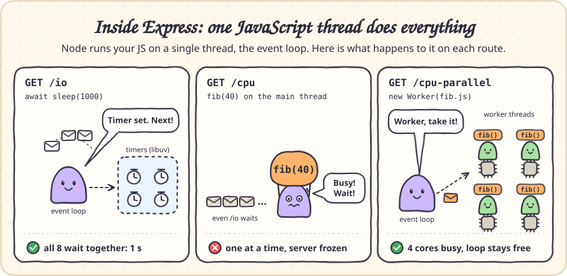
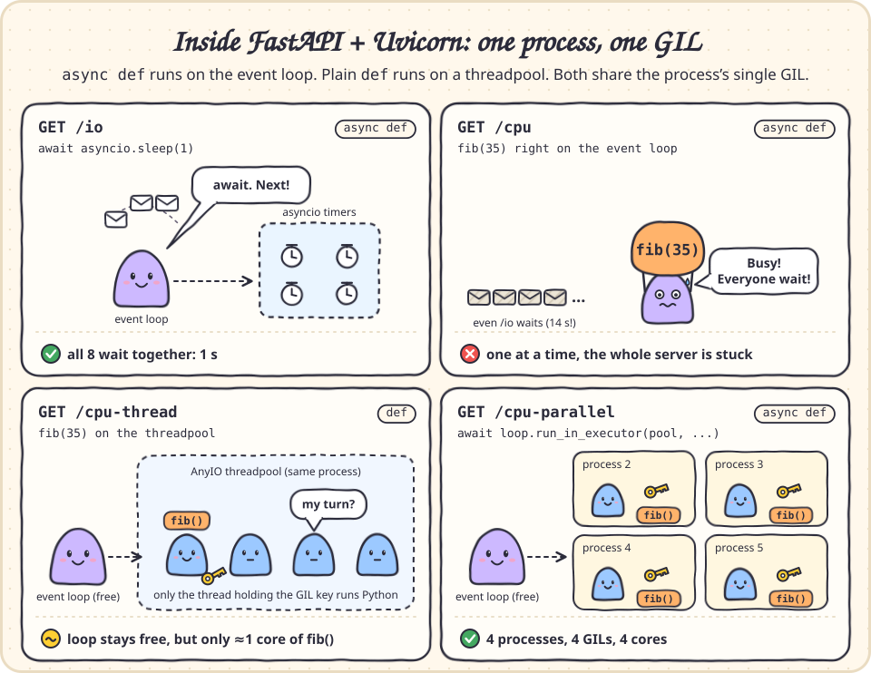
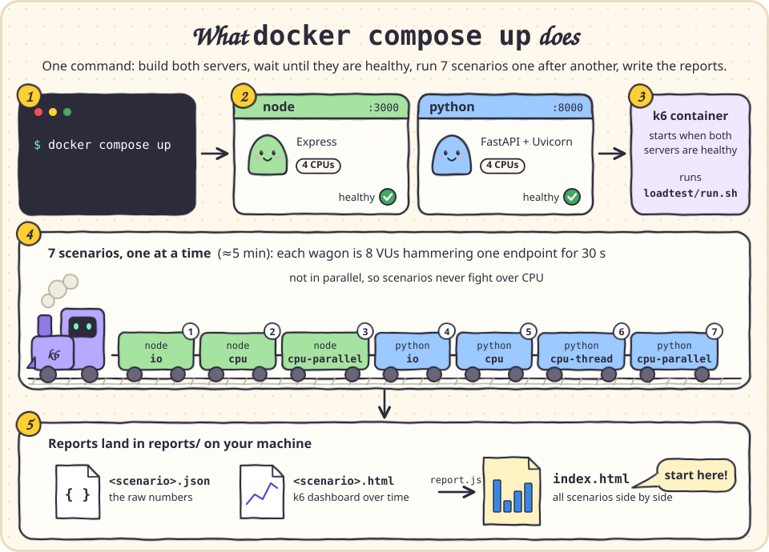
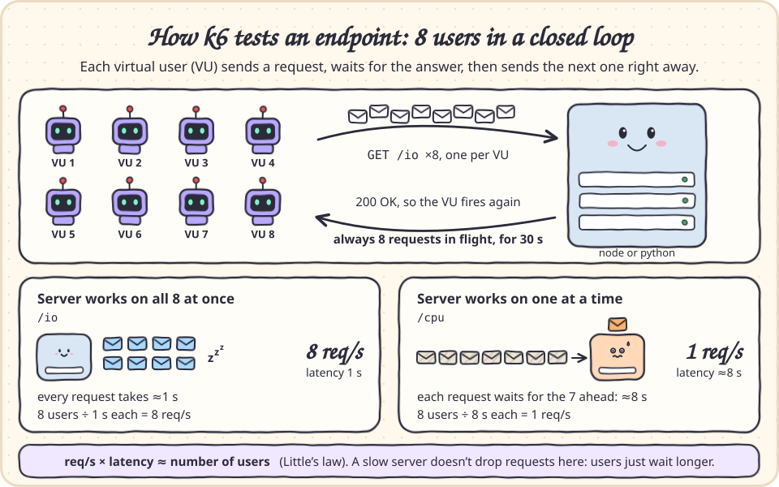

# Concurrency vs Parallelism: Express vs FastAPI

- **Concurrency**: *dealing* with many things at once. One worker switches between tasks whenever a task is waiting (on a DB, the network, or a timer).
- **Parallelism**: *doing* many things at once. Several CPU cores execute code at the same instant.

Waiting (I/O) only needs concurrency. Heavy computation (CPU) needs parallelism.



```
node/               Express: server.js + fib.js (CPU work, also usable as a worker thread)
python/             FastAPI: main.py
bench.sh            fires N requests at the same instant and prints each latency + the total
docker-compose.yml  runs both servers + the k6 load test with one command
loadtest/           k6: run.sh (scenario list), test.js (one scenario), report.js (comparison page)
reports/            HTML reports written by the load test
docs/img/           the illustrations in this README
```

There are two ways to see it: a quick manual check with `bench.sh` (below), or [the k6 load test](#load-test-with-k6) with HTML reports.

## Run manually

```bash
# Express -> http://localhost:3000   (PORT=3001 npm start if 3000 is taken)
cd node && npm install && npm start

# FastAPI + Uvicorn -> http://localhost:8000
cd python && python3 -m venv .venv && .venv/bin/pip install -r requirements.txt
.venv/bin/uvicorn main:app --port 8000
```

Then, from the repo root:

```bash
./bench.sh http://localhost:3000/io        # 4 simultaneous requests (default)
./bench.sh http://localhost:8000/cpu 8     # or pick N
```

## What you'll see (4 simultaneous requests, each one ≈1s of work)



| Endpoint | Work | Latencies | Total | Why |
|---|---|---|---|---|
| node `/io` | `await sleep(1s)` | 1, 1, 1, 1 | **~1s** | Concurrency: the one JS thread is free while it waits |
| node `/cpu` | `fib()` on the main thread | 1, 2, 3, 4 | **~4s** | The one JS thread is busy, so requests queue |
| node `/cpu-parallel` | `fib()` in a `Worker` | 1, 1, 1, 1 | **~1s** | Parallelism: 4 threads on 4 cores (see `threadId`) |
| py `/io` | `await asyncio.sleep(1)` | 1, 1, 1, 1 | **~1s** | Concurrency: the event loop interleaves the awaits |
| py `/cpu` | `fib()` in `async def` | 1, 2, 3, 4 | **~4s** | Blocks the event loop, just like Node |
| py `/cpu-thread` | `fib()` in plain `def` (threadpool) | 4, 4, 4, 4 | **~4s** | 4 threads, but the **GIL** lets only one run Python at a time |
| py `/cpu-parallel` | `fib()` in a `ProcessPoolExecutor` | 1, 1, 1, 1 | **~1s** | Parallelism: 4 processes, each with its own GIL (see `pid`) |

How to read the latencies:

- **1, 2, 3, 4** (a staircase): requests waited in line behind a single busy thread.
- **4, 4, 4, 4**: requests took turns on one core. They ran concurrently, but not in parallel.
- **1, 1, 1, 1**: the requests really overlapped.

## What happens inside each server

Both servers have a single event loop. The question on every route is whether the work keeps that loop busy or gets handed off.





## Load test with k6

One command builds both servers, load-tests every endpoint with [k6](https://grafana.com/docs/k6/), and writes HTML reports:

```bash
docker compose up
```

It takes about 5 minutes. When the log says `Done. Open reports/index.html`, press Ctrl+C to stop the servers. To have them stop on their own, use `docker compose up --abort-on-container-exit`. Remove the containers with `docker compose down`.

| File | What's in it |
|---|---|
| `reports/index.html` | **Start here.** Throughput and latency of every scenario side by side, plus the full metrics table |
| `reports/<scenario>.html` | k6's dashboard for one scenario: request rate, latency percentiles, and VUs over time |
| `reports/<scenario>.json` | The raw numbers behind the comparison page |

### How the test works



1. `docker-compose.yml` starts `node` and `python`, caps each at **4 CPUs** (so "parallel" means the same thing on every machine), and waits for their healthchecks. The servers aren't published to your host ports.
2. The `k6` container runs `loadtest/run.sh`, which holds the list of scenarios. It runs them **one at a time**, so they never compete for CPU.
3. Each scenario (`loadtest/test.js`) is a closed loop. **8 virtual users (VUs)** each send a request, wait for the response, and immediately send the next one, for **30 s**. So there are always 8 requests in flight.
4. `loadtest/report.js` builds `reports/index.html` from the per-scenario results.



Every request is about 1 s of work: a 1 s wait for `/io`, or `fib()` for the CPU endpoints (~0.85 s on the machine below). That makes the ideal results easy to predict:

| If the server... | Throughput | Latency |
|---|---|---|
| works on all 8 requests at once | ≈ 8 req/s | ≈ 1 s |
| works on one request at a time | ≈ 1 req/s | ≈ 8 s (7 in line ahead of you, plus your own) |
| runs them in parallel on 4 CPUs | ≤ 4 req/s | ≈ 2 s |

Throughput × average latency ≈ 8 (the number of users) on every row. This is Little's law: a slow server doesn't drop requests here; each user just waits longer.

### What each metric means

- **Requests**: completed HTTP requests (k6 `http_reqs`).
- **Req/s (throughput)**: how many requests the server finished per second. This is how much work it gets through.
- **Avg / Median / p95 / Max (latency)**: time from sending a request to getting the full response (k6 `http_req_duration`), *including time spent queued* behind other requests. p95 = 95% of requests were faster than this.
- **Failed**: share of requests that errored or got a non-2xx/3xx status (k6 `http_req_failed`). It's 0% everywhere: slow is not the same as broken.

### Results

Measured with the defaults (8 VUs, 30 s, 4 CPUs) on a Ryzen 5 5600G (6 cores / 12 threads). Your exact numbers will differ, but the pattern won't.

| Scenario | Requests | Req/s | Avg | p95 | Max | What it shows |
|---|---|---|---|---|---|---|
| `node-io` | 240 | **7.99** | **1.00 s** | 1.00 s | 1.01 s | concurrency |
| `node-cpu` | 43 | **1.19** | **6.18 s** | 13.28 s | 24.36 s | one thread, blocked |
| `node-cpu-parallel` | 105 | **3.34** | **2.38 s** | 3.06 s | 3.31 s | parallelism (worker threads) |
| `python-io` | 240 | **7.98** | **1.00 s** | 1.00 s | 1.00 s | concurrency |
| `python-cpu` | 41 | **1.11** | **6.59 s** | 7.35 s | 7.39 s | one thread, blocked |
| `python-cpu-thread` | 38 | **1.10** | **6.97 s** | 9.83 s | 12.02 s | threads, but the GIL serializes them |
| `python-cpu-parallel` | 104 | **3.35** | **2.35 s** | 3.00 s | 3.74 s | parallelism (processes) |

### Scenarios

#### 1. `node-io`: Express `GET /io`, `await sleep(1000)`

- **What happens:** the only JS thread starts a timer and is immediately free to accept the next request. All 8 requests wait *at the same time*.
- **Result:** 8 req/s at exactly 1 s. This is the ideal: concurrency alone is enough when the work is waiting.
- **In the dashboard:** flat lines. The request rate stays at 8/s and latency is pinned at 1 s.

#### 2. `node-cpu`: Express `GET /cpu`, `fib(40)` on the main thread

- **What happens:** `fib()` keeps the only JS thread busy, so Node finishes one request at a time while the other 7 wait. The whole server is frozen meanwhile; even `/io` couldn't answer.
- **Result:** 1.19 req/s at ~6 s average. Throughput doesn't care how many users there are; more users only make the line longer.
- **Look at the tail:** the average is close to the predicted ~7 s, but one request waited **24 s**. Node doesn't take queued requests in arrival order, so some requests are unlucky again and again. **Averages hide this; p95 and max show it.** In this scenario's dashboard, the latency line climbs in steps (5 → 9 → 13 → 18 → 24 s) as that request keeps getting skipped.

#### 3. `node-cpu-parallel`: Express `GET /cpu-parallel`, `fib(40)` in a new `Worker` per request

- **What happens:** each request runs on its own worker thread, and the OS runs those threads on different cores at the same time.
- **Result:** 3.34 req/s at ~2.4 s. That's about 3× `/cpu` for the same `fib()`, and the tail is tight (max 3.3 s), so no request gets starved.
- **Why not 8×, or even 4×?** The container only has 4 CPUs, so 8 threads take turns. Oversubscribing also costs extra on this machine: 8 busy threads share 6 physical cores (hyper-threading), and the cap counts CPU *time*, so each CPU-second gets less done. With `VUS=4` (one thread per CPU), the same endpoint did **4.44 req/s at 0.90 s**. More threads than cores made it *slower*.

#### 4. `python-io`: FastAPI `GET /io`, `await asyncio.sleep(1)` in `async def`

- **What happens:** the same as Node. `await` hands the event loop back while waiting, so all 8 requests wait at once on a single thread.
- **Result:** 8 req/s at 1 s, identical to `node-io`. For waiting, both runtimes are equally good.

#### 5. `python-cpu`: FastAPI `GET /cpu`, `fib(35)` inside `async def`

- **What happens:** `async def` routes run *on* the event loop. CPU work there blocks it exactly like Node's `/cpu`: one request at a time, and the whole server stalls. While this scenario's load ran, a single `/io` call took **14 s** instead of 1 s.
- **Result:** 1.11 req/s at ~6.6 s.
- **Unlike Node:** the tail is tight (max 7.4 s vs 24 s). Requests are served roughly in arrival order, so everyone waits about the same.

#### 6. `python-cpu-thread`: FastAPI `GET /cpu-thread`, `fib(35)` inside plain `def`

- **What happens:** FastAPI runs plain `def` routes on a threadpool. That gives 8 threads working on 8 requests at once, which is concurrency. But the GIL lets only one thread execute Python at a time, so they take turns on what is effectively one core.
- **Result:** 1.10 req/s, the same as `/cpu`. Threads add no CPU power to pure-Python code. Latency is a bit worse and less even (max 12 s) because of the constant switching.
- **What threads *do* buy you:** the event loop stays free. Under this load, a `/io` call took **1.4 s** instead of the 14 s it took under `/cpu`, so the rest of the app keeps working. That makes `def` the right tool for *blocking I/O* (`requests`, a sync DB driver), not for CPU work.

#### 7. `python-cpu-parallel`: FastAPI `GET /cpu-parallel`, `fib(35)` on a `ProcessPoolExecutor`

- **What happens:** each process has its own interpreter and its own GIL, so `fib()` really runs on several cores at once.
- **Result:** 3.35 req/s at ~2.4 s, about 3× `/cpu` and the same ceiling as Node's workers. With `VUS=4` it did **4.25 req/s at 0.94 s**, the same oversubscription effect as scenario 3.

### Change the experiment

All three knobs are environment variables:

```bash
VUS=4 docker compose up                # one user per CPU: parallel endpoints get close to ideal (~4.4 req/s, ~0.9 s)
VUS=16 DURATION=1m docker compose up   # double the users: expect blocked endpoints' latency to double while throughput stays put
CPUS=2 docker compose up               # fewer cores: expect the parallel endpoints to lose about half their throughput
```

If Docker has fewer than 4 CPUs available (Docker Desktop: Settings → Resources), lower `CPUS` or the containers won't start. To add a scenario, add a line to `loadtest/run.sh`.

## Try also

```bash
# Blocking the main thread freezes *every* route, even cheap ones (~1.8s instead of 1s):
curl -s localhost:3000/cpu > /dev/null & curl -s -w '%{time_total}s\n' -o /dev/null localhost:3000/io

# More processes = parallelism with no code changes. The blocking /cpu now takes ~1s for 4 requests:
.venv/bin/uvicorn main:app --port 8000 --workers 4    # Node equivalent: node:cluster or pm2 -i 4
```

## Takeaways

- **Node/Express** runs your JS on one thread. Async I/O gives you concurrency for free. CPU-heavy work blocks the whole server, so move it to `worker_threads` (or a pool such as `piscina`), or run more processes.
- **FastAPI**:
  - `async def` routes run on the event loop. Never block them with `time.sleep`, `requests`, or heavy CPU work.
  - Plain `def` routes run in a threadpool. That's fine for blocking I/O but no help for CPU work, because of the GIL.
  - For CPU work, use a `ProcessPoolExecutor` or `uvicorn --workers N`.
  - Free-threaded Python builds (`3.13t` and later) have no GIL, so there `/cpu-thread` becomes parallel too.
